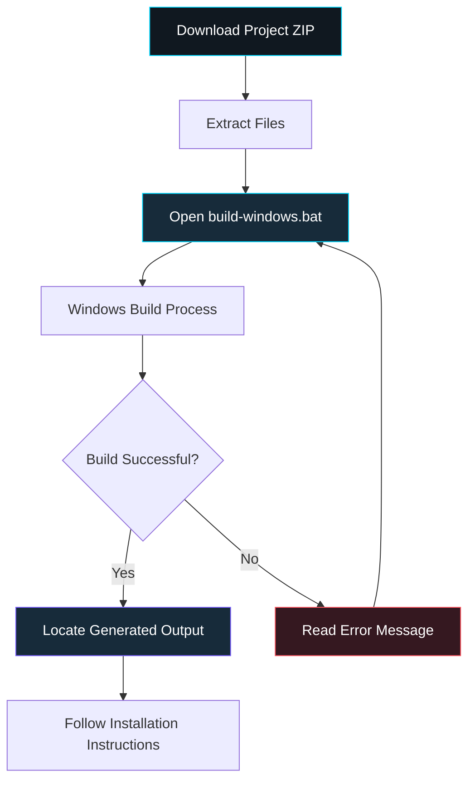

# ⚡ CYBERCIRCUIT CLIENT 26.1

  
  
  

  <strong>YOUR MINECRAFT. YOUR MODULES. YOUR CIRCUIT.</strong>

A futuristic Minecraft client project built around customisation, development, and the CyberCircuit identity.

---

## ⚡ GETTING STARTED

### 📥 1. Download the project

Download the project ZIP from GitHub and extract it into a folder on your Windows PC.

### 🛠️ 2. Build the client

**IMPORTANT: You must run `build-windows.bat` to build the client.**

1. Open the extracted CyberCircuit Client folder.
2. Find **`build-windows.bat`**.
3. Double-click the file to launch the build process.
4. Allow the script to finish. If Windows asks for permission, review the prompt before proceeding.
5. Read the terminal output for errors or a successful build message.

> **Don't skip this step:** Opening the project folder alone does not build the client. The batch file runs the project's Windows build process.

If the window reports an error, take a screenshot of the complete error message before trying again.

### 🎮 3. Find and use the build

After the script finishes, check its output and the project's build instructions to find the generated client.

The output location depends on how `build-windows.bat` is configured. If the script builds a JAR, follow the project's Minecraft installation instructions to install it. Do not assume the client has been installed automatically.

---

## 🔀 HOW IT WORKS

## 🚀 PROJECT DETAILS

- **Project:** CyberCircuit Client
- **Version:** 26.1
- **Platform:** Windows build workflow
- **Edition:** Minecraft Java Edition
- **Build script:** `build-windows.bat`

## ⚠️ TROUBLESHOOTING

- **The file won't open:** Confirm that you extracted the ZIP and that `build-windows.bat` exists.
- **The build fails:** Read the terminal output and check the project's prerequisites.
- **The window closes too quickly:** Run the batch file from an already-open Command Prompt so you can read the output.
- **You can't find the client:** Check the build script and its output directories for the generated files.
- **Minecraft won't load it:** Verify the Minecraft version, loader, dependencies, and installation instructions for the specific build.

## 🌐 THE CIRCUIT STARTS HERE

CyberCircuit Client 26.1 is the original 26.1 branch of the CyberCircuit project. Check the repository for updates, source code, and additional documentation.

**YOUR MINECRAFT. YOUR MODULES. YOUR CIRCUIT.** ⚡

