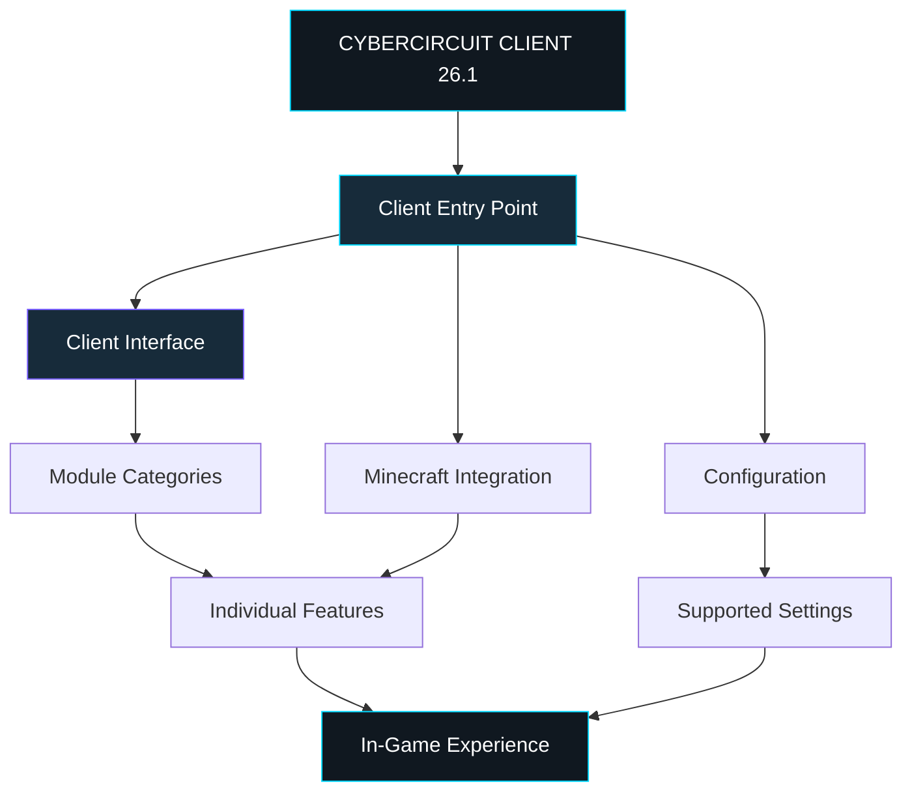

# ⚡ CYBERCIRCUIT CLIENT 26.1

<p align="center">
  
  
  
</p>

<p align="center">
  <strong>YOUR MINECRAFT. YOUR MODULES. YOUR CIRCUIT.</strong>
</p>

<p align="center">
  A custom Minecraft Java Edition client project built around a distinct identity, configurable functionality, and an evolving client experience.
</p>

<p align="center">
  <em>One client. One ecosystem. Infinite room to improve.</em>
</p>

---

# 01 — INTRODUCTION

## Welcome to CyberCircuit.

CyberCircuit Client 26.1 is the original 26.1 branch of the CyberCircuit Minecraft client project.

This repository is dedicated to the development, documentation, maintenance, and distribution of this particular version. It serves as the central place for its source code, development history, issues, release information, and future improvements.

The goal behind CyberCircuit is to bring client-side functionality together through a cohesive experience, rather than treating every tool as an isolated feature.

A client should be easy to understand, straightforward to navigate, and designed with enough flexibility to support future development.

CyberCircuit combines that philosophy with its own technological identity: dark interfaces, electric accents, a circuit-inspired aesthetic, and a focus on practical functionality.

### What is CyberCircuit Client?

CyberCircuit Client is an independent Minecraft client project intended to provide a custom client experience with a consistent visual identity and an extensible foundation.

The project may include client interfaces, utility modules, configuration options, and supported integrations according to the capabilities of each build.

This repository covers **CyberCircuit Client 26.1 only**.

It is separate from the later CyberCircuit Client 26.2 project and the Cyber Cracked Launcher project.

> **Version notice:** The project name and intended direction do not guarantee that every feature described in this document is already implemented. Consult the source code and release notes to establish what is available in a particular build.

---

# 02 — PROJECT ARCHITECTURE

## How the client experience fits together



The diagram illustrates the intended relationship between the client entry point, Minecraft integration, interface, configuration, and in-game experience. It is a conceptual overview rather than a verified inventory of implemented classes or modules.

---

# 03 — BEFORE YOU INSTALL

## What you need

Before installing CyberCircuit Client 26.1, prepare the following:

1. **A Windows PC or another supported computer.** These instructions focus on Windows and Minecraft Java Edition.
2. **Minecraft Java Edition.** You need a legitimate Minecraft Java Edition installation compatible with the specific CyberCircuit build.
3. **The correct CyberCircuit Client 26.1 release file.** Download the artifact published for this project, not a file belonging to version 26.2 or another launcher.
4. **Any required loader or dependencies.** If the release is a Fabric mod, you need a compatible Fabric installation and the required Fabric API version if the mod depends on it. Other packaging types may have different requirements.
5. **Enough free disk space.** Minecraft installations, libraries, mods, logs, and game files require additional storage.
6. **An internet connection.** The official launcher may need to download Minecraft files, libraries, or dependencies on the first launch.

### Check your Minecraft version

1. Open the Minecraft Launcher.
2. Select **Minecraft: Java Edition**.
3. Open the installations list.
4. Check the game version of the installation you intend to use.
5. Compare it with the Minecraft version specified by the CyberCircuit 26.1 release.

Do not assume that a project called `26.1` automatically supports every Minecraft version with a similar number. Use the exact version documented by the release.

---

# 04 — DOWNLOAD CYBERCIRCUIT CLIENT 26.1

## Step 1: Open the correct repository

1. Open the GitHub repository that contains the original CyberCircuit Client 26.1 project.
2. Read the repository title and description.
3. Confirm that you are in the original **26.1** repository.
4. Look for the **Releases** section, if the project publishes releases.
5. Open the latest release specifically intended for version 26.1.

If there is no Releases section or no published release, check the repository's installation instructions before downloading source files.

## Step 2: Choose the correct file

A release may contain different types of files. Their purposes are not interchangeable.

| File type | Purpose |
|---|---|
| `.jar` | May be a Minecraft mod, a standalone Java application, or another Java artifact. Its actual purpose depends on how it was built. |
| `.zip` | May contain source code, a modpack, or a collection of installation files. Inspect its contents before using it. |
| Source code archive | Intended for inspecting or building the project, not necessarily for direct installation. |
| Installer | Use only if the project actually publishes a supported installer and documents how to use it. |

**Important:** Do not rename a ZIP or source archive to `.jar`. Changing a filename does not convert a file into an installable Minecraft mod.

## Step 3: Download the release

1. Select the documented release asset.
2. Download it to a folder you can find easily, such as `Downloads`.
3. Wait for the download to finish.
4. If the project publishes a checksum, compare the downloaded file against it.
5. Keep the original file until the installation has been tested.

Only download releases from the project location you trust. Do not run unexpected executables or scripts from an unverified download.

---

# 05 — INSTALLATION GUIDE

The correct installation method depends on how CyberCircuit Client 26.1 is packaged. Follow the section that matches the actual release.

## Method A — If CyberCircuit 26.1 is a Fabric mod

Use this method only if the project identifies its release as a Fabric mod.

### Step 1: Install the required Minecraft version

1. Open the official Minecraft Launcher.
2. Launch the required vanilla Minecraft version at least once.
3. Close Minecraft after the title screen loads.
4. Make sure the launcher can start that version successfully.

### Step 2: Install Fabric Loader

1. Obtain the Fabric Installer from the official Fabric website: https://fabricmc.net/use/installer/
2. Open the installer.
3. Select the **Client** installation option.
4. Choose the Minecraft version required by CyberCircuit Client 26.1.
5. Select the appropriate loader version if the project specifies one.
6. Install the profile.
7. Open the Minecraft Launcher and check that the Fabric profile is available.

Do not select a different Minecraft version simply because it appears newer.

### Step 3: Locate your Minecraft game directory

The default Windows game directory is:

```text
%APPDATA%\.minecraft
```

To open it:

1. Press `Windows + R`.
2. Enter `%APPDATA%\.minecraft`
3. Press Enter.

If you use a custom game directory, use that directory instead.

### Step 4: Find or create the mods folder

Inside the correct game directory:

1. Look for a folder named `mods`.
2. If it does not exist, create a folder named exactly `mods`.
3. Keep the folder name lowercase.

The usual location is:

```text
%APPDATA%\.minecraft\mods
```

If the installation uses a separate game directory, the `mods` folder belongs inside that directory instead.

### Step 5: Install CyberCircuit

1. Find the downloaded CyberCircuit `.jar` file.
2. Verify that the release instructions identify it as the Fabric mod.
3. Copy the file into the correct `mods` folder.
4. Do not extract the JAR.
5. Install any additional dependencies explicitly required by the release.
6. Check that those dependencies support the same Minecraft and Fabric versions.

Your folder may look similar to this:

```text
.minecraft/
├── mods/
│   ├── cybercircuit-client-26.1.jar
│   └── required-dependency.jar
├── versions/
├── assets/
└── libraries/
```

The filenames shown above are examples. Your actual files may have different names, and you should not create placeholder JAR files.

### Step 6: Launch the Fabric profile

1. Open the Minecraft Launcher.
2. Select Minecraft: Java Edition.
3. Select the Fabric profile for the required game version.
4. Click **Play**.
5. Wait for Minecraft to finish loading.
6. Check for an error message if the game closes unexpectedly.

If the game opens normally, continue to the usage guide below.

---

## Method B — If the release is a standalone Java application

A standalone Java application is not automatically a Minecraft mod.

1. Read the release instructions to identify the application's entry point.
2. Check the required Java version.
3. Install that Java version from a trusted distribution if necessary.
4. Follow the project's documented launch command or application launcher.
5. Do not put a standalone application JAR into the Minecraft `mods` folder unless the project explicitly identifies it as a Minecraft mod.

If the project provides a `.bat` launcher, inspect its instructions and use it only if you trust its contents.

---

## Method C — If you downloaded source code

Source code is intended for developers or users who need to build the application.

1. Extract the source archive to a normal working folder.
2. Open the project's documentation.
3. Check for files such as `README.md`, `build.gradle`, `settings.gradle`, `gradlew.bat`, or `fabric.mod.json`.
4. Follow the build instructions for the exact project.
5. Install any required development tools.
6. Build the project using its documented Gradle command if it uses Gradle.
7. Find the generated artifact in the output directory specified by the build.
8. Install that artifact using the method appropriate to its packaging.

Do not assume that every source archive can be built by double-clicking a file.

---

# 06 — FIRST LAUNCH

## Start CyberCircuit Client 26.1

Once installation is complete:

1. Open the Minecraft Launcher.
2. Select **Minecraft: Java Edition**.
3. Choose the installation you prepared for CyberCircuit Client 26.1.
4. Check that the selected Minecraft version matches the client requirements.
5. Click **Play**.
6. Wait for the game to load.
7. Reach the Minecraft title screen.
8. Check for any error messages or missing dependency warnings.

If CyberCircuit loads as a mod, its interface or functionality should become available according to the implementation of that build.

If you cannot identify the client in-game, do not immediately reinstall everything. First check that the correct profile, game directory, and release file are being used.

## Confirm that it loaded

Use the following checklist:

- [ ] Minecraft launches without crashing.
- [ ] The correct game version is running.
- [ ] The intended loader is active, if one is required.
- [ ] The CyberCircuit release is in the correct location.
- [ ] All required dependencies are present.
- [ ] The client interface or documented functionality is accessible.
- [ ] The game log does not report a CyberCircuit loading error.

If one of these checks fails, use the troubleshooting section.

---

# 07 — HOW TO USE THE CLIENT

## Step 1: Understand the interface

CyberCircuit's intended design centres on a cohesive client interface and configurable functionality.

Depending on the actual build, an interface may provide access to feature categories, settings, information panels, or individual modules. Only controls present in the installed build should be treated as available.

When you first open the client:

1. Look for the main client interface.
2. Read the labels on its tabs, buttons, and categories.
3. Identify any settings or module controls.
4. Check whether the interface includes a help panel or control list.
5. Change one setting at a time so that you can identify its effect.

Do not assume a specific keyboard shortcut without checking the source code or documentation for version 26.1.

## Step 2: Open the client interface

1. Start Minecraft using the correct CyberCircuit installation.
2. Load into a suitable test world or another environment supported by the client.
3. Consult the release notes or in-game controls for the interface-opening key.
4. Press the documented key or use the documented interface control.
5. Confirm that the interface appears.
6. If nothing happens, check the key bindings and game logs.

**Keyboard shortcut:** The correct interface-opening key must be verified against the original 26.1 implementation. Do not assume that `Right Shift` is supported merely because other Minecraft clients use it.

## Step 3: Navigate categories

If your build includes category tabs:

1. Open the main interface.
2. Select a category.
3. Read the available options.
4. Select a feature to view its controls, if supported.
5. Return to the category list when finished.
6. Repeat for the other available categories.

Category names and feature counts depend on the actual build. Use the labels displayed by the application rather than assuming that every category exists.

## Step 4: Enable or disable a feature

If a feature has an enable/disable control:

1. Find the feature in its category.
2. Read its name and any accompanying description.
3. Toggle it on.
4. Observe what changes.
5. Toggle it off again to confirm that the control works.
6. Keep the feature disabled if it causes instability or behaves unexpectedly.

Not every setting is necessarily a toggle. Some controls may be sliders, text fields, dropdowns, or buttons.

## Step 5: Configure a feature

For features with settings:

1. Open the relevant feature's settings.
2. Read each option before changing it.
3. Adjust one option at a time.
4. Apply or save the change if the interface requires it.
5. Test the change in a suitable environment.
6. Restore the original value if the result is unexpected.

Some features may apply changes immediately, while others may require a world reload or game restart. Follow the behaviour documented by the build.

## Step 6: Change general settings

If the client provides general settings:

1. Open the settings area.
2. Review the available options.
3. Adjust the desired option.
4. Save the settings if there is a save button.
5. Close and reopen the interface to see whether the change persists.
6. Restart Minecraft if the setting requires a restart.

Avoid editing internal configuration files while the game is running unless the project explicitly supports that workflow.

## Step 7: Close the interface

Use the documented close button or the same key that opens the interface, if the implementation supports that behaviour.

If the interface stops responding:

1. Wait briefly.
2. Try the documented close control.
3. Avoid repeatedly pressing random key combinations.
4. If necessary, close Minecraft normally.
5. Check the logs before relaunching.

---

# 08 — CONFIGURATION AND SAVED SETTINGS

## Where are settings stored?

The location and format of CyberCircuit's configuration files depend on the implementation of version 26.1.

A mod may use a configuration file in the Minecraft game directory or a dedicated subfolder. A standalone application may store its settings elsewhere.

To locate the correct files:

1. Close Minecraft or the application.
2. Open the game directory used by your installation.
3. Look for a configuration folder or a file mentioned in the project's documentation.
4. Check the source code if the location is not documented.
5. Back up the original file before making manual changes.

Do not create a configuration file from scratch unless the project documents its required format.

## Back up your configuration

1. Close the application.
2. Locate the confirmed configuration file or directory.
3. Copy it to a separate backup folder.
4. Make any intended changes.
5. Launch the application and test them.
6. Restore the backup if the configuration causes problems.

Keep backups separate from the original file so you can recover from mistakes.

---

# 09 — TROUBLESHOOTING

## Problem: CyberCircuit does not appear in Minecraft

Check the following:

1. Confirm that you installed the intended CyberCircuit 26.1 release.
2. Check that it is in the correct game directory.
3. Verify that you selected the correct launcher profile.
4. Confirm that the Minecraft version matches the release requirements.
5. Verify the required loader and dependencies.
6. Read the game log for a loading error.

If the project is a Fabric mod, the presence of its JAR in the correct `mods` folder is an important first check.

## Problem: Minecraft crashes during startup

1. Record the error message.
2. Open the game's `logs` folder.
3. Inspect `latest.log`.
4. If Minecraft generated a crash report, open the newest relevant report.
5. Check for missing dependencies or incompatible versions.
6. Remove recently added third-party mods one at a time to identify a conflict.
7. Test with a separate game directory if necessary.

Do not delete your entire `.minecraft` folder as a first troubleshooting step. Back up important worlds and settings before making significant changes.

## Problem: The interface key does nothing

1. Confirm that the client actually loaded.
2. Check the documented key binding.
3. Open Minecraft's Controls settings if the client registers a configurable key.
4. Check for a key conflict.
5. Restart the game after changing a binding if necessary.
6. Review the log for errors.

Do not assume the default is `Right Shift` unless that has been verified for version 26.1.

## Problem: A dependency error appears

1. Read the error message carefully.
2. Identify the missing library or mod.
3. Check the CyberCircuit release notes.
4. Download the dependency from its official source.
5. Select the version compatible with the required Minecraft version and loader.
6. Restart the application.

Installing an arbitrary newer dependency can introduce additional compatibility problems.

## Problem: Settings do not persist

1. Check whether the application has a save or apply control.
2. Confirm that you are editing the configuration for the correct game directory.
3. Close the application normally.
4. Reopen it and test again.
5. Check for configuration errors in the log.
6. Verify that the configuration file is writable.

## Problem: Minecraft works without CyberCircuit but crashes with it

1. Back up the relevant world and configuration files.
2. Reproduce the issue in a test world.
3. Record the steps that trigger the crash.
4. Save the relevant logs and crash report.
5. Check for version incompatibilities.
6. Report the problem with the CyberCircuit release version, Minecraft version, loader version, and relevant error details.

Do not publish account tokens, passwords, or other private information in an issue report.

---

# 10 — UPDATING OR REMOVING CYBERCIRCUIT

## Updating the client

1. Close Minecraft.
2. Back up your configuration and any files you want to preserve.
3. Read the new release notes.
4. Confirm that the new version supports your Minecraft installation.
5. Follow the documented upgrade instructions.
6. Replace the old artifact if the release instructions require it.
7. Install any updated dependencies.
8. Launch the game and verify that the client works.

Do not keep multiple incompatible versions of the same mod in the `mods` folder.

## Removing the client

For a Fabric mod installation:

1. Close Minecraft.
2. Open the correct game directory.
3. Open the `mods` folder.
4. Identify the CyberCircuit JAR by its actual filename.
5. Move it to a backup folder or remove it.
6. Remove dependencies only if you are certain that other mods do not need them.
7. Launch the original Minecraft profile and verify that it works.

For a standalone application, follow its documented uninstall or removal instructions instead.

**World safety:** Back up important worlds before removing mods that add blocks, items, entities, or other world-dependent content.

---

# 11 — BUILDING FROM SOURCE

This section is for developers who want to compile CyberCircuit Client 26.1.

## Requirements

Check the project's build files for the exact requirements. Depending on the project, these may include:

- A compatible Java Development Kit (JDK).
- Git, if you are cloning the repository.
- Gradle or the project's Gradle Wrapper.
- The correct Minecraft development environment.
- Required dependencies and libraries.

Do not assume that a JDK version used by another CyberCircuit project is automatically correct for version 26.1.

## Build procedure

1. Open the original CyberCircuit Client 26.1 repository.
2. Read its build instructions.
3. Download or clone the source code.
4. Open a terminal in the project root.
5. Confirm that the required JDK is installed.
6. Run the documented build command.
7. Wait for Gradle to finish.
8. Read the build output and resolve any reported errors.
9. Locate the generated artifact in the output directory specified by the project.
10. Test the build in a separate Minecraft installation before distributing it.

If the project contains `gradlew.bat`, a documented Windows build may use the Gradle Wrapper, for example:

```bat
gradlew.bat build
```

Run this command from the directory containing `gradlew.bat`. This is a general Gradle example; the exact task and required setup must be confirmed from the original project's build configuration.

## Test before distributing

A successful compilation does not guarantee that the client is stable.

- Test startup.
- Verify that the client loads in the intended Minecraft version.
- Test the documented controls.
- Check settings persistence.
- Review the logs.
- Test with and without other supported mods.
- Document known limitations before publishing a release.

---

# 12 — REPORTING BUGS AND REQUESTING FEATURES

When reporting a problem, include:

1. The CyberCircuit Client version.
2. The Minecraft version.
3. The loader and its version, if applicable.
4. Your operating system.
5. The steps required to reproduce the problem.
6. What you expected to happen.
7. What actually happened.
8. Relevant log output or a crash report.

For feature requests, explain the intended behaviour, why it would be useful, and how it should interact with existing functionality.

Keep reports focused so that issues can be reproduced and investigated.

Use the repository's available Issues or Discussions features if they are enabled.

---

# 13 — PROJECT SCOPE

CyberCircuit Client 26.1 is the original 26.1 branch of the CyberCircuit client project.

This repository is distinct from:

- CyberCircuit Client 26.2.
- Cyber Cracked Launcher.
- Other projects that may share a similar name or visual identity.

Features, release files, build instructions, controls, and dependencies should be documented for the specific version they apply to.

A feature planned for a future release should not be presented as an existing feature until it has been implemented and tested.

---

# 14 — QUICK-START CHECKLIST

Use this checklist when installing CyberCircuit for the first time.

- [ ] Open the correct CyberCircuit Client 26.1 repository.
- [ ] Download the documented release artifact.
- [ ] Confirm the supported Minecraft version.
- [ ] Install the required loader and dependencies, if applicable.
- [ ] Put the artifact in the correct location for its packaging.
- [ ] Select the intended Minecraft installation.
- [ ] Launch the game.
- [ ] Confirm that CyberCircuit loads.
- [ ] Open the client interface using the documented control.
- [ ] Test the available features and settings.
- [ ] Back up the configuration once everything works.

---

<p align="center">
  <strong>CYBERCIRCUIT CLIENT 26.1</strong>
</p>

<p align="center">
  YOUR MINECRAFT. YOUR MODULES. YOUR CIRCUIT.
</p>
